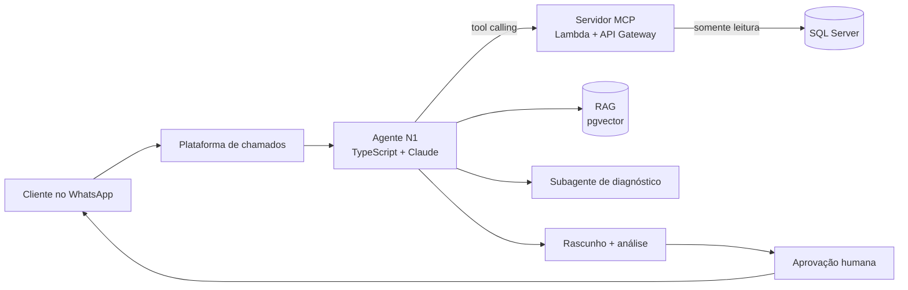

# Agente de IA para suporte N1 com acesso controlado a dados

**PT** | [EN](#english)

**Contexto:** GE Finance, julho a setembro de 2026. Papel: engenheiro de IA e principal autor.
**Stack:** TypeScript, Claude via Vercel AI SDK, MCP, AWS Lambda e API Gateway, SQL Server, PostgreSQL/pgvector, GitHub Actions.
**Evidência:** relato de projeto interno. O código é da empresa e não está aqui.

## Problema

O suporte de um SaaS financeiro e fiscal para vendedores de marketplace respondia chamados que quase sempre dependiam de olhar dados no banco. Na linha de base que medi, eram 545 chamados com mediana de 4,7 dias até o encerramento. A ideia era um agente de atendimento N1 que investigasse o chamado e entregasse uma análise com rascunho de resposta, sempre aprovado por uma pessoa.

O risco principal era dar a um LLM acesso a dados financeiros de muitos clientes. Por isso o desenho começou pelo que o agente não pode fazer.

## Arquitetura

O servidor MCP é o único caminho de dados do agente. O agente não tem credencial de banco.

## Decisões técnicas

- **Consultas fechadas.** O MCP expõe 31 consultas SQL fixas e parametrizadas, somente leitura, com limites de linhas, de tempo e de concorrência. O modelo escolhe qual consulta chamar e com quais parâmetros; nunca escreve SQL.
- **Isolamento por cliente.** O cliente (tenant) vem do cadastro, não do texto da mensagem. Quem escreve "sou o cliente X" não muda o escopo.
- **Texto do cliente é dado, não instrução.** Defesa contra prompt injection tratada como requisito, com testes de segurança, autenticação por OTP e trilha de auditoria.
- **Schema validado.** Mais de 430 testes no servidor MCP e 1.067 colunas conferidas contra o schema real, para que uma mudança no banco quebre o teste e não a produção.
- **RAG com regra de procedência.** Casos passados e documentação do produto ficam em ChromaDB, migrado depois para PostgreSQL/pgvector. A regra: padrão vem da busca semântica, fato vem do SQL. Nenhuma afirmação ao cliente sem resultado de ferramenta.
- **Evals antes de autonomia.** 51 casos reais estratificados dos 545 chamados, 10 deles selados e usados só para decidir. A taxa de aceite por família de problema é o critério para liberar autonomia aos poucos.
- **Arquitetura em camadas.** O domínio não depende da plataforma de agentes. 42 verificações de CI, nascidas de falhas reais: vazamento de credencial, rajada de mensagens, estouro de concorrência. Decisões em ADRs.

## Números

| Item | Valor |
| --- | --- |
| Consultas fechadas no MCP | 31 |
| Testes no servidor MCP | 430+ |
| Colunas validadas contra o schema | 1.067 |
| Casos de eval | 51 (10 selados), de 545 chamados |
| Verificações de CI | 42 |
| Linha de base | 545 chamados, mediana de 4,7 dias |

## Outros resultados

- Corrigi o método da taxa de resolutividade do painel de suporte, que passava de 100% por misturar coortes.
- Mapeei 176 repositórios e 74 serviços do Elastic APM (consultas ES|QL) para o agente usar como referência só código ativo em produção.
- Por iniciativa própria, montei um fluxo multiagente de diagnóstico N3 que revelou retenção de log de apenas 24 horas em parte dos índices, limitação até então não documentada.

## O que aprendi

Em agente com dados sensíveis, o controle fica na camada de ferramentas, não no prompt. Eval com casos selados evita ajustar o agente até ele "passar" no que já viu. E medir a linha de base antes de construir mudou a conversa: sem ela, qualquer ganho seria opinião.

## Limites

Não declaro ganho de tempo de atendimento: o projeto mediu a linha de base, não um resultado pós-implantação. Código, dados e nomes internos permanecem privados.

---

## English

**Context:** GE Finance, July to September 2026. Role: AI engineer and primary author.
**Stack:** TypeScript, Claude via the Vercel AI SDK, MCP, AWS Lambda and API Gateway, SQL Server, PostgreSQL/pgvector, GitHub Actions.
**Evidence:** account of an internal project. The code belongs to the company and is not included.

### Problem

Support for a financial and tax SaaS used by marketplace sellers handled tickets that almost always required looking at database records. The baseline I measured was 545 tickets with a median of 4.7 days to close. The goal was an L1 agent that investigates a ticket and returns an analysis with a draft reply, always approved by a person.

The main risk was giving an LLM access to financial data from many customers, so the design started from what the agent must not be able to do.

### Architecture

The diagram above applies. The MCP server is the agent's only data path, and the agent holds no database credentials.

### Technical decisions

- **Closed queries.** The MCP server exposes 31 fixed, parameterized, read-only SQL queries with row, time and concurrency limits. The model picks a query and its parameters; it never writes SQL.
- **Per-tenant isolation.** The tenant comes from the account record, not from the message text. Writing "I am customer X" does not change scope.
- **Customer text is data, not instructions.** Prompt injection defense is a requirement, covered by security tests, OTP authentication and an audit trail.
- **Validated schema.** 430+ tests on the MCP server and 1,067 columns checked against the real schema, so a database change breaks a test instead of production.
- **RAG with a provenance rule.** Past cases and product docs live in ChromaDB, later migrated to PostgreSQL/pgvector. Patterns come from semantic search, facts come from SQL. No claim reaches the customer without a tool result.
- **Evals before autonomy.** 51 real cases stratified from the 545 tickets, 10 of them sealed and used only for decisions. The acceptance rate per problem family decides how much autonomy to grant.
- **Layered architecture.** The domain does not depend on the agent platform. 42 CI checks, each born from a real failure: credential leak, message burst, concurrency overrun. Decisions recorded in ADRs.

### Other results

- Fixed the support dashboard's resolution-rate method, which exceeded 100% because it mixed cohorts.
- Mapped 176 repositories and 74 Elastic APM services (ES|QL) so the agent referenced only code live in production.
- On my own initiative, built a multi-agent L3 diagnostic workflow that uncovered a 24-hour log retention limit on part of the indices, previously undocumented.

### What I learned

With sensitive data, control belongs in the tool layer, not in the prompt. Sealed eval cases stop you from tuning the agent until it passes what it has already seen. Measuring the baseline first changed the conversation: without it, any gain would be opinion.

### Limits

I do not claim a faster-resolution result: the project measured the baseline, not a post-rollout outcome. Code, data and internal names remain private.
