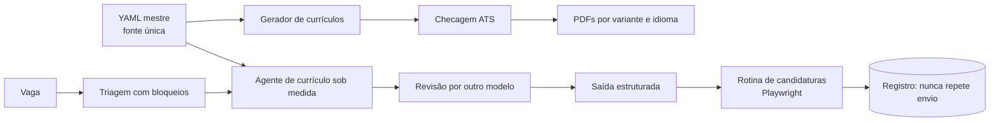

# Automação de carreira: currículos com lastro e um agente sob medida

**PT** | [EN](#english)

**Contexto:** projeto pessoal, 2026. Papel: autor.
**Stack:** Python, Playwright, JSON Schema, Codex e Claude como modelos.
**Evidência:** relato de projeto pessoal. O código é privado de propósito.

## Problema

Manter vários currículos (por área e por idioma) e candidatar-se com consistência gera retrabalho e risco de inconsistência: o número que aparece em um PDF e não no outro, a resposta de formulário que contradiz o currículo. Quis tratar isso como um problema de engenharia: uma fonte de verdade e verificações automáticas.

## Arquitetura

## Decisões técnicas

- **Uma fonte, vários currículos.** Um YAML mestre gera todas as variantes. Editar um lugar só evita divergência.
- **Checagem ATS no gerador.** Uma coluna, texto extraível, 2 páginas e números com lastro: cada afirmação numérica aponta para uma fonte registrada no próprio YAML.
- **Rotina diária com Playwright em 4 portais de vagas.** Triagem com bloqueios (critérios que impedem o envio), respostas de formulário com lastro nos dados do mestre e um registro que nunca repete um envio.
- **Dois fornecedores de modelo.** No agente de currículo sob medida, um modelo redige e outro, de fornecedor diferente, revisa. A revisão cruzada reduz o ponto cego de um modelo só.
- **Saída estruturada.** O resultado obedece a um JSON Schema.
- **Guard contra prompt injection na vaga.** O texto da vaga é entrada não confiável e é tratado como dado.
- **Cobertura de palavras-chave e nota mínima.** Se a nota fica abaixo do mínimo, o sistema escala para um modelo mais forte.
- **Falha sem bloquear.** Um fallback garante que um erro do agente nunca impeça a candidatura de seguir com o currículo padrão.

## Números

~186 testes. O restante é qualitativo: a fonte única e os bloqueios existem para impedir erros que antes dependiam de atenção.

## O que aprendi

"Número com lastro" é uma regra que cabe em código: se a afirmação não aponta para uma fonte, o gerador não a publica. E, em agente que escreve em meu nome, o importante é o que ele é impedido de fazer.

## Limites

Projeto pessoal, sem métrica de taxa de resposta. Detalhes de operação nos sites de vagas ficam de fora de propósito; este case trata da engenharia e do uso de IA.

---

## English

**Context:** personal project, 2026. Role: author.
**Stack:** Python, Playwright, JSON Schema, Codex and Claude as models.
**Evidence:** account of a personal project. The code is private on purpose.

### Problem

Maintaining several resumes (per field and per language) and applying consistently creates rework and inconsistency risk: a number that shows in one PDF and not another, a form answer that contradicts the resume. I treated it as an engineering problem: one source of truth and automatic checks.

### Architecture

See the diagram above.

### Technical decisions

- **One source, many resumes.** A master YAML generates every variant. Editing one place prevents drift.
- **ATS check in the generator.** One column, extractable text, 2 pages, and numbers with backing: each numeric claim points to a source recorded in the YAML itself.
- **Daily routine with Playwright across 4 job portals.** Screening with blockers (criteria that stop a submission), form answers grounded in the master data, and a log that never repeats a submission.
- **Two model vendors.** In the tailored-resume agent, one model drafts and a model from a different vendor reviews. Cross-review reduces the blind spot of a single model.
- **Structured output.** Results follow a JSON Schema.
- **Prompt injection guard on the job posting.** Posting text is untrusted input and is handled as data.
- **Keyword coverage and a minimum score.** If the score falls under the minimum, the system escalates to a stronger model.
- **Failing without blocking.** A fallback ensures an agent error never stops an application from going out with the default resume.

### Numbers

About 186 tests. The rest is qualitative: the single source and the blockers exist to prevent mistakes that used to depend on attention.

### What I learned

"Numbers with backing" is a rule that fits in code: if a claim does not point to a source, the generator does not publish it. And for an agent that writes in my name, what matters most is what it is prevented from doing.

### Limits

Personal project, no response-rate metric. Operational details about job sites are left out on purpose; this case is about engineering and the use of AI.
