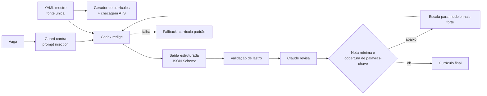

# Agente de currículo sob medida, com revisão cruzada e lastro

**PT** | [EN](#english)

**Contexto:** projeto pessoal, 2026. Papel: autor.
**Stack:** Python, JSON Schema, Codex e Claude como modelos.
**Evidência:** relato de projeto pessoal. O código é privado de propósito.

## Problema

Adaptar um currículo a cada vaga com um LLM é fácil. Difícil é garantir que o texto não invente nada: um número que não existe, uma tecnologia que nunca usei, uma instrução escondida na vaga que o modelo obedece. Tratei como um problema de engenharia de IA: o modelo escreve, o código decide o que passa.

## Arquitetura

## Decisões técnicas

- **Dois fornecedores de modelo.** Um modelo redige e outro, de fornecedor diferente, revisa. A revisão cruzada reduz o ponto cego de um modelo só.
- **Saída estruturada.** A resposta do modelo precisa obedecer a um JSON Schema; o que não valida, não segue.
- **Validação de lastro.** Nenhum número ou termo fora do perfil mestre passa. Cada afirmação numérica aponta para uma fonte registrada no próprio YAML.
- **Guard contra prompt injection.** O texto da vaga é entrada não confiável e é tratado como dado, nunca como instrução.
- **Cobertura de palavras-chave e nota mínima.** Abaixo da nota mínima, o sistema escala para um modelo mais forte.
- **Fallback que nunca bloqueia.** Se o agente falha, o fluxo segue com o currículo padrão em vez de parar.
- **Evals com vagas reais.** Um conjunto de vagas reais mede o agente a cada mudança de prompt ou de modelo.
- **Gerador de currículos com checagem ATS.** Um YAML mestre gera todas as variantes por área e idioma, com checagem de uma coluna, texto extraível e 2 páginas, e números com lastro.

O agente é integrado a uma rotina pessoal de candidaturas.

## Números

~186 testes. O restante é qualitativo: as regras existem para impedir erros que antes dependiam de atenção.

## O que aprendi

"Número com lastro" é uma regra que cabe em código: se a afirmação não aponta para uma fonte, o sistema não a publica. Em agente que escreve em meu nome, o mais importante é o que ele é impedido de fazer.

## Limites

Projeto pessoal, sem métrica de taxa de resposta das candidaturas.

---

## English

**Context:** personal project, 2026. Role: author.
**Stack:** Python, JSON Schema, Codex and Claude as models.
**Evidence:** account of a personal project. The code is private on purpose.

### Problem

Tailoring a resume to each job posting with an LLM is easy. The hard part is guaranteeing the text invents nothing: a number that does not exist, a technology I never used, an instruction hidden in the posting that the model obeys. I treated it as an AI engineering problem: the model writes, the code decides what gets through.

### Architecture

See the diagram above.

### Technical decisions

- **Two model vendors.** One model drafts and a model from a different vendor reviews. Cross-review reduces the blind spot of a single model.
- **Structured output.** The model response must satisfy a JSON Schema; what does not validate does not proceed.
- **Backing validation.** No number or term outside the master profile gets through. Each numeric claim points to a source recorded in the YAML itself.
- **Prompt injection guard.** The posting text is untrusted input and is handled as data, never as instructions.
- **Keyword coverage and a minimum score.** Below the minimum score, the system escalates to a stronger model.
- **A fallback that never blocks.** If the agent fails, the flow continues with the default resume instead of stopping.
- **Evals with real postings.** A set of real postings measures the agent on every prompt or model change.
- **Resume generator with ATS check.** One master YAML generates every variant by field and language, checking single column, extractable text, 2 pages, and numbers with backing.

The agent is integrated into a personal job-application routine.

### Numbers

About 186 tests. The rest is qualitative: the rules exist to prevent mistakes that used to depend on attention.

### What I learned

"Numbers with backing" is a rule that fits in code: if a claim does not point to a source, the system does not publish it. For an agent that writes in my name, what matters most is what it is prevented from doing.

### Limits

Personal project, with no response-rate metric for applications.
