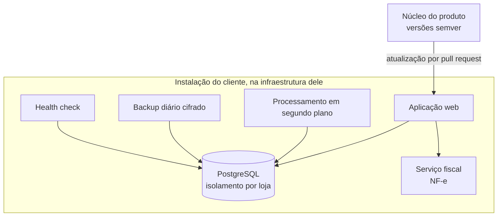

# Genoma: ERP para pequenos negócios, instalado na infraestrutura do cliente

**PT** | [EN](#english)

**Contexto:** syphrax, 2026. Papel: autor do produto.
**Stack:** Next.js 16, React 19, TypeScript, PostgreSQL 17, Docker Compose, serviço fiscal em PHP.
**Estado:** v1.0.0, produto validado.
**Evidência:** relato de produto. Código privado.

## Problema

Pequenos comércios costumam escolher entre planilhas e um SaaS em que os dados ficam com o fornecedor. O Genoma segue outro caminho: o ERP é instalado na infraestrutura do próprio cliente, e o cliente é dono do servidor e dos dados. O desafio é manter várias instalações atualizáveis, seguras e recuperáveis sem acesso manual a cada uma.

## Arquitetura

## Decisões técnicas

- **Núcleo e instalações por cliente.** Cada cliente tem uma instalação própria, ligada ao núcleo do produto. As atualizações chegam por pull request e seguem versionamento semântico. As migrações de banco são só aditivas, para que uma versão nova não quebre uma instalação que ainda não atualizou.
- **Isolamento multi-loja no banco.** O PostgreSQL impõe o isolamento entre lojas com Row-Level Security. A aplicação roda com um papel de banco sem poder de contornar essa regra e sem ser dona das tabelas; migrações e fila usam um papel separado, que a aplicação não recebe. Um erro de consulta na aplicação não expõe dados de outra loja.
- **Deploy que se desfaz sozinho.** Todo deploy começa com um backup e volta atrás automaticamente se o health check falhar.
- **Backup que se prova.** Backup diário criptografado e teste mensal de restauração automatizado. O health check cobre banco, processamento em segundo plano, papéis de banco e a idade do último backup.
- **NF-e em serviço separado.** Um serviço dedicado cuida da assinatura do XML com certificado ICP-Brasil e isola a parte fiscal do restante.
- **Autenticação.** Login com segundo fator.

## Escopo e números

| Item | Valor |
| --- | --- |
| Módulos de negócio | 8: caixa, delivery, financeiro, fiscal, estoque, pessoas, compras e vendas, com multi-loja no núcleo |
| Migrations | 43 |
| Rotas de API | 142 |
| Casos de teste | ~2.800 |
| Versão | v1.0.0 |

## O que aprendi

Quando o cliente é dono dos dados, a operação faz parte do produto: backup, restauração, rollback e health check pesam tanto quanto as telas. Migração só aditiva é uma regra chata que evita a maior parte dos sustos de atualização.

## Limites

Contagem de testes não é cobertura percentual. Não divulgo clientes nem detalhes de implementação. Código privado.

---

## English

**Context:** syphrax, 2026. Role: product author.
**Stack:** Next.js 16, React 19, TypeScript, PostgreSQL 17, Docker Compose, a PHP fiscal service.
**Status:** v1.0.0, validated product.
**Evidence:** product account. Private code.

### Problem

Small shops usually choose between spreadsheets and a SaaS where the vendor holds the data. Genoma takes another route: the ERP is installed on the customer's own infrastructure, and the customer owns the server and the data. The challenge is keeping many installations updatable, secure and recoverable without manual access to each one.

### Architecture

See the diagram above.

### Technical decisions

- **Core plus per-customer installations.** Each customer has their own installation, tied to the product core. Updates arrive as pull requests and follow semantic versioning. Database migrations are additive only, so a new version does not break an installation that has not updated yet.
- **Multi-store isolation in the database.** PostgreSQL enforces isolation between stores with Row-Level Security. The application runs with a database role that cannot bypass that rule and owns no tables; migrations and the queue use a separate role the application never receives. A query bug in the application cannot expose another store's data.
- **A deploy that undoes itself.** Every deploy starts with a backup and rolls back automatically if the health check fails.
- **A backup that proves itself.** Daily encrypted backup plus an automated monthly restore test. The health check covers the database, background processing, database roles and the age of the last backup.
- **NF-e in a separate service.** A dedicated service signs the XML with an ICP-Brasil certificate and keeps the fiscal part isolated.
- **Authentication.** Login with a second factor.

### Scope and numbers

8 business modules (cash register, delivery, finance, tax, inventory, people, purchasing, sales), with multi-store in the core; 43 migrations; 142 API routes; about 2,800 test cases; v1.0.0.

### What I learned

When the customer owns the data, operations are part of the product: backup, restore, rollback and health checks weigh as much as the screens. Additive-only migrations are a boring rule that prevents most update scares.

### Limits

Test counts are not coverage percentages. I do not disclose customers or implementation details. Private code.
