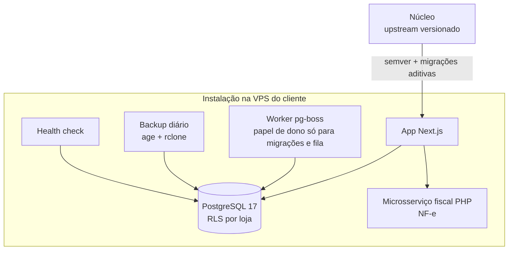

# Genoma: ERP para pequenos negócios instalado na VPS do cliente

**PT** | [EN](#english)

**Contexto:** syphrax, 2026. Papel: autor do produto (458 commits do autor). Levantamento de 23/10/2026.
**Stack:** Next.js 16, React 19, TypeScript, Drizzle, PostgreSQL 17, pg-boss, better-auth (2FA), Docker Compose, PHP (microsserviço fiscal).
**Estado:** v1.0.0 pronta para piloto. Não afirmo clientes em produção.
**Evidência:** relato de projeto. Código privado.

## Problema

Pequenos comércios costumam escolher entre planilhas e um SaaS onde os dados ficam com o fornecedor. A proposta do Genoma é outra: o ERP roda no servidor do próprio cliente, e o cliente é dono do servidor e dos dados. O desafio é manter várias instalações atualizáveis sem perder esse isolamento.

## Arquitetura

## Decisões técnicas

- **Núcleo e instalações-filhas.** Cada cliente tem uma instalação com upstream no núcleo. As atualizações seguem semver e as migrações são só aditivas, para uma versão nova não quebrar uma instalação que ainda não atualizou.
- **Multi-loja com Row-Level Security.** O isolamento entre lojas é imposto pelo PostgreSQL. O app roda com um papel sem BYPASSRLS e sem ser dono de tabela; migrações e a fila usam um papel separado, que o app não recebe. Um erro de query no app não expõe dados de outra loja.
- **Deploy que se desfaz sozinho.** O deploy faz backup prévio e volta atrás automaticamente se o health check falhar.
- **Backup que se prova.** Backup diário criptografado (age + rclone) e teste mensal de restauração automatizado. O health check cobre banco, worker, papel de banco e idade do último backup.
- **NF-e em serviço separado.** Um microsserviço em PHP cuida da assinatura do XML com certificado ICP-Brasil e isola o trecho fiscal do restante.
- **Autenticação.** better-auth com 2FA.

## Escopo e números

| Item | Valor |
| --- | --- |
| Módulos | 8 de negócio (caixa, delivery, financeiro, fiscal, estoque, pessoas, compras, vendas), com multi-loja no núcleo |
| Tabelas / migrations | 62 / 43 |
| Rotas de API | 142 |
| Casos de teste | ~2.800 em 330 arquivos |
| Versão | v1.0.0 |

## O que aprendi

Quando o cliente é dono dos dados, operação vira parte do produto: backup, restauração, rollback e health check pesam tanto quanto as telas. E migração só aditiva é uma regra chata que evita a maior parte dos sustos de atualização.

## Limites

A v1.0.0 está pronta para piloto; não há afirmação de uso em produção por clientes. Contagem de testes não é cobertura percentual. Código privado.

---

## English

**Context:** syphrax, 2026. Role: product author (458 commits by the author).
**Stack:** Next.js 16, React 19, TypeScript, Drizzle, PostgreSQL 17, pg-boss, better-auth (2FA), Docker Compose, PHP (fiscal microservice).
**Status:** v1.0.0, pilot-ready. I make no claim of customers in production.
**Evidence:** project account. Private code.

### Problem

Small shops usually pick between spreadsheets and a SaaS where the vendor holds the data. Genoma takes another route: the ERP runs on the customer's own server, and the customer owns the server and the data. The challenge is keeping several installations updatable without losing that isolation.

### Architecture

See the diagram above.

### Technical decisions

- **Core plus child installations.** Each customer has an installation with the core as upstream. Updates follow semver and migrations are additive only, so a new version does not break an installation that has not updated yet.
- **Multi-store with Row-Level Security.** PostgreSQL enforces isolation between stores. The app runs with a role that has no BYPASSRLS and owns no table; migrations and the queue use a separate role the app never receives. A query bug in the app cannot expose another store's data.
- **A deploy that undoes itself.** Deploy takes a backup first and rolls back automatically if the health check fails.
- **A backup that proves itself.** Daily encrypted backup (age and rclone) plus an automated monthly restore test. The health check covers database, worker, database role and age of the last backup.
- **NF-e in a separate service.** A PHP microservice handles XML signing with an ICP-Brasil certificate and keeps the fiscal part isolated.
- **Authentication.** better-auth with 2FA.

### Scope and numbers

8 business modules (cash register, delivery, finance, tax, inventory, people, purchasing, sales), with multi-store in the core; 62 tables; 43 migrations; 142 API routes; about 2,800 test cases in 330 files; v1.0.0.

### What I learned

When the customer owns the data, operations become part of the product: backup, restore, rollback and health checks weigh as much as the screens. And additive-only migrations are a boring rule that prevents most update scares.

### Limits

v1.0.0 is pilot-ready; I make no claim of customer use in production. Test counts are not coverage percentages. Private code.
