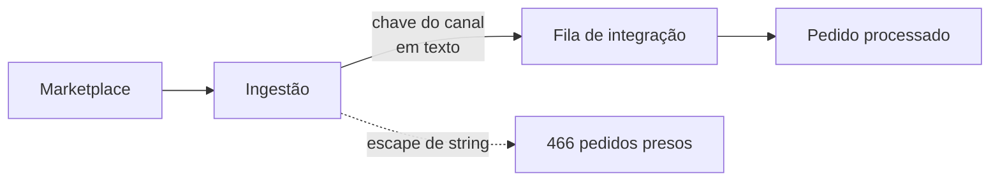
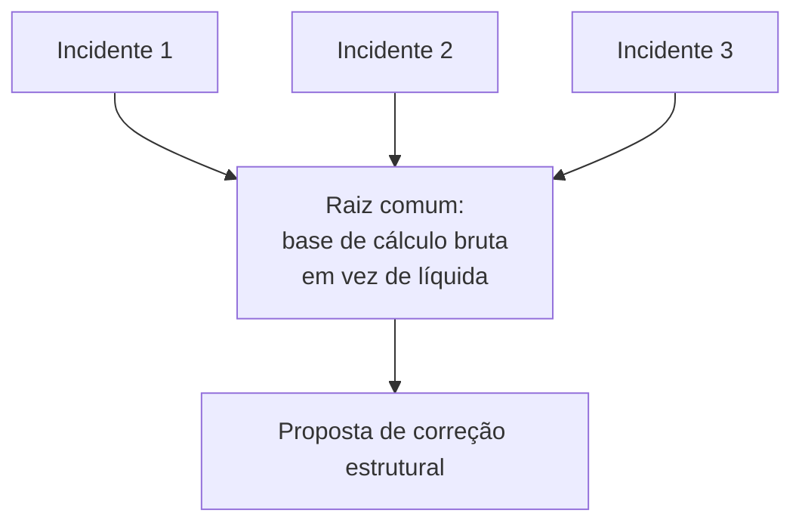

# Sustentação N3: causa raiz em pedidos presos e erros de cálculo fiscal

**PT** | [EN](#english)

**Contexto:** GE Finance, agosto de 2025 a junho de 2026. Papel: analista de sustentação sênior, referência técnica em escalonamentos N3.
**Stack:** SQL Server (4 bases de produção), .NET/C#, Python, AWS Lambda, Elastic.
**Evidência:** relato da minha atuação. Dados, consultas, clientes e código são da empresa e não estão aqui.

## Problema

Dois tipos de chamado chegavam ao N3 com cara de caso isolado: pedidos que não andavam numa fila de integração e valores fiscais que não batiam. Corrigir um a um resolvia o chamado do dia e deixava a causa no sistema.

## Caso 1: 466 pedidos presos por dois meses

O sintoma era a fila parada. A causa estava no tratamento de uma chave textual do canal na ingestão: o escape de string no pipeline de ingestão falhava e o pedido nunca avançava.

- Rastreei a causa com consultas, logs do Elastic e leitura do código das integrações.
- Destravei os 466 pedidos, com remediação em lote validada em amostra.
- Propus migrar a chave do canal de texto para ID numérico em 5 fases. A correção imediata e a migração têm escopos diferentes: a primeira resolveu os pedidos, a segunda ataca a fragilidade. A migração é proposta, não entrega concluída.

## Caso 2: família de defeitos bruto × líquido

- O motor de cálculo calculava um crédito fiscal de comissão sobre o valor bruto, ignorando o abatimento do marketplace. Isso gerava risco de crédito tributário indevido. Documentei a causa técnica e a fiscal e escalei.
- Três incidentes tratados como independentes tinham a mesma raiz. Agrupei como uma família de defeitos e troquei três remendos por uma proposta de correção estrutural.
- Em outro caso, o crédito sobre um produto estava subdimensionado: R$ 3,76 gravado contra cerca de R$ 23,64 esperado por venda. Validei a correção e reprocessei as vendas do cliente afetado.

## Como trabalhei

- Separar sintoma de causa antes de mexer em dados.
- SQL Server cross-database em quatro bases, com CTEs, window functions, tabelas temporárias e hints de lock.
- Remediação em lote validada em amostra.
- Registro de incidentes N3 (causa raiz, impacto, clientes afetados, responsável), que o time passou a usar como referência.

## O que aprendi

O padrão vale mais que o incidente. Quando três chamados parecem diferentes, vale perguntar o que eles têm em comum antes de abrir o quarto.

## Limites

O resultado documentado é o destravamento dos 466 pedidos e a correção do caso de R$ 3,76. Não atribuo receita recuperada nem redução percentual de incidentes, porque isso não foi medido.

---

## English

**Context:** GE Finance, August 2025 to June 2026. Role: senior support analyst, technical reference for L3 escalations.
**Stack:** SQL Server (4 production databases), .NET/C#, Python, AWS Lambda, Elastic.
**Evidence:** account of my own work. Data, queries, customers and code belong to the company and are not included.

### Problem

Two kinds of tickets reached L3 looking like one-offs: orders stuck in an integration queue, and tax values that did not add up. Fixing them one by one closed the day's ticket and left the cause in the system.

### Case 1: 466 orders stuck for two months

The symptom was a stalled queue. The cause was how ingestion handled a text-based channel key: string escaping in the ingestion pipeline failed, so the order never advanced.

- Traced the cause with queries, Elastic logs and reading the integration code.
- Unblocked the 466 orders, with batch remediation validated on a sample.
- Proposed migrating the channel key from text to a numeric ID in 5 phases. The immediate fix and the migration have different scopes: the first freed the orders, the second removes the fragility. The migration is a proposal, not a completed delivery.

### Case 2: the gross versus net defect family

- The calculation engine computed a commission tax credit on the gross amount, ignoring the marketplace rebate, which risked an undue tax credit. I documented the technical and tax cause and escalated.
- Three incidents treated as independent shared one root. I grouped them as a defect family and replaced three patches with a structural fix proposal.
- In another case, a product credit was understated: R$ 3.76 recorded versus about R$ 23.64 expected per sale. I validated the fix and reprocessed the affected customer's sales.

### How I worked

- Separate symptom from cause before touching data.
- Cross-database SQL Server across four databases: CTEs, window functions, temp tables and lock hints.
- Batch remediation validated on a sample.
- An L3 incident register (root cause, impact, affected customers, owner) that the team adopted as its reference.

### What I learned

The pattern is worth more than the incident. When three tickets look different, ask what they share before opening the fourth.

### Limits

The documented outcomes are the 466 unblocked orders and the R$ 3.76 correction. I do not claim recovered revenue or a percentage drop in incidents; neither was measured.
