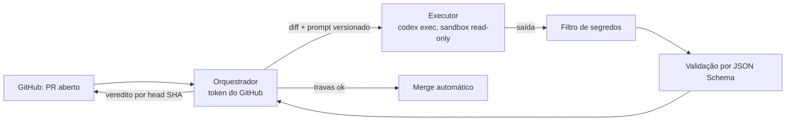

# Argos: revisor de pull requests com LLM, em contêineres isolados

**PT** | [EN](#english)

**Contexto:** syphrax, 2026. Papel: autor.
**Stack:** Node.js, Codex CLI, JSON Schema, Docker, seccomp, AppArmor, API do GitHub. Satélites: Íris (CLI em Python) e um monitor serverless (Cloudflare Workers e D1).
**Evidência:** relato de projeto interno. Código privado.

## Problema

Pull requests precisavam de uma revisão consistente e de um merge com regras, sem depender de alguém estar disponível. Pôr um LLM para ler código de terceiros e decidir um merge cria dois riscos: o modelo ser enganado pelo conteúdo do PR, e o executor ter poder demais caso isso aconteça.

## Arquitetura

O orquestrador e o executor rodam em 2 contêineres isolados, com seccomp e AppArmor. O token do GitHub fica só no orquestrador; o executor, que lê código não confiável, não o possui.

## Decisões técnicas

- **Executor sem poder de escrita.** O modelo roda via `codex exec` em sandbox read-only. Ele opina; quem age é o orquestrador.
- **Saída estruturada e validada.** A resposta precisa obedecer a um JSON Schema. Texto livre fora do formato é rejeitado, então o merge não depende de interpretar prosa.
- **Prompts versionados.** Mudar o critério de revisão é uma mudança de código, revisável e reversível.
- **Filtro de vazamento.** Se a saída do modelo tiver padrão de credencial, ela é descartada inteira antes de virar comentário, em vez de mascarada.
- **Revisão presa ao head SHA.** O veredito vale para o commit revisado. Se o PR muda, a aprovação antiga deixa de valer.
- **Merge com travas.** O merge automático exige veredito APPROVE sem achados Critical ou Important, head igual ao revisado, todo o CI verde, PR sem conflito mirando o branch padrão, autor membro da organização e não bot, diff abaixo do limite e nenhum arquivo sensível (migrations, auth, CI, Dockerfile, contratos). Branch `agent/` nunca é mergeado sozinho.
- **Separação de tokens.** Credenciais diferentes para quem lê código e para quem age no GitHub.

## Coadjuvantes

- **Íris:** CLI em Python (só biblioteca padrão) que envia relatórios pelo WhatsApp. 50 testes.
- **Monitor serverless:** Cloudflare Workers e D1, checagem a cada minuto. 31 testes.

## Números

| Item | Valor |
| --- | --- |
| Testes do Argos | 198 |
| Contêineres isolados | 2 (seccomp + AppArmor) |
| Testes da Íris / do monitor | 50 / 31 |

## O que aprendi

Em ferramenta com LLM, o modelo é a parte menos confiável do sistema, e o desenho deve assumir isso: sandbox sem escrita, saída validada, segredo filtrado e decisão na mão de código determinístico.

## Limites

Não afirmo taxa de acerto das revisões nem tempo economizado: não foram medidos. Código privado.

---

## English

**Context:** syphrax, 2026. Role: author.
**Stack:** Node.js, Codex CLI, JSON Schema, Docker, seccomp, AppArmor, GitHub API. Satellites: Íris (Python CLI) and a serverless monitor (Cloudflare Workers and D1).
**Evidence:** account of an internal project. Private code.

### Problem

Pull requests needed consistent review and rule-gated merging without depending on someone being available. Letting an LLM read untrusted code and influence a merge creates two risks: the model being steered by PR content, and the executor having too much power if that happens.

### Architecture

See the diagram above. The orchestrator and the executor run in 2 isolated containers with seccomp and AppArmor. The GitHub token lives only in the orchestrator; the executor, which reads untrusted code, does not hold it.

### Technical decisions

- **An executor with no write power.** The model runs through `codex exec` in a read-only sandbox. It gives an opinion; the orchestrator acts.
- **Validated structured output.** The response must satisfy a JSON Schema. Free text outside the format is rejected, so merging never depends on interpreting prose.
- **Versioned prompts.** Changing the review criteria is a code change: reviewable and reversible.
- **Leak filter.** If model output contains a credential pattern, it is discarded entirely before becoming a comment, instead of being masked.
- **Review bound to the head SHA.** The verdict applies to the reviewed commit. If the PR changes, the old approval stops counting.
- **Gated merge.** Auto-merge requires an APPROVE verdict with no Critical or Important findings, an unchanged head, all CI green, a conflict-free PR targeting the default branch, an org-member non-bot author, a diff under the size limit and no sensitive files (migrations, auth, CI, Dockerfiles, contracts). `agent/` branches are never auto-merged.
- **Separate tokens.** Different credentials for whoever reads code and whoever acts on GitHub.

### Satellites

- **Íris:** a Python CLI (standard library only) that sends reports over WhatsApp. 50 tests.
- **Serverless monitor:** Cloudflare Workers and D1, checking every minute. 31 tests.

### Numbers

198 tests for Argos; 2 isolated containers (seccomp and AppArmor); 50 tests for Íris; 31 for the monitor.

### What I learned

In LLM tooling the model is the least trustworthy part of the system, and the design should assume it: a sandbox with no write access, validated output, filtered secrets, and the decision in deterministic code.

### Limits

I do not claim review accuracy or time saved; neither was measured. Private code.
