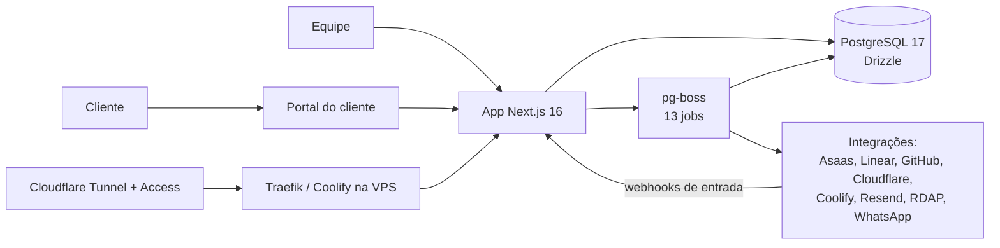

# ERP e backoffice próprio da syphrax

**PT** | [EN](#english)

**Contexto:** syphrax, desde setembro de 2026. Papel: cofundador e CTO, autor de cerca de 840 commits desde 26/09/2026.
**Stack:** Next.js 16, React 19, TypeScript, PostgreSQL 17, Drizzle, pg-boss, Vitest, Playwright, Docker, Coolify, Traefik, Cloudflare.
**Evidência:** relato do sistema que uso e mantenho. Código privado.

## Problema

A empresa precisava de um sistema único para operar: CRM, propostas, contratos, financeiro, NFS-e, projetos e acompanhamento de clientes, com portal para o cliente. Vários SaaS soltos deixariam dados e permissões espalhados. Construir exigia que o sistema fosse seguro e testável desde o início, porque ele guarda dinheiro e dados pessoais.

## Arquitetura

## Decisões técnicas

- **Uma base, 15 áreas.** O sistema cobre 15 áreas e o portal do cliente, com 68 tabelas e 43 migrations versionadas.
- **Permissão em quatro eixos.** Controle de acesso por papel, módulo, ação e escopo. Login com Google e TOTP.
- **Auditoria que o app não consegue apagar.** O log é append-only, e isso é imposto no banco, não por convenção do código.
- **LGPD como funcionalidade.** Anonimização, exportação de dados e retenção são rotinas do sistema.
- **Filas em vez de trabalho no request.** 13 jobs em pg-boss, que usa o próprio PostgreSQL como fila e evita um serviço a mais para operar.
- **Integrações.** Mais de 8 sistemas externos: Asaas (cobrança, conciliação e NFS-e), Linear, GitHub, Cloudflare, Coolify, Resend, RDAP e WhatsApp.
- **Segurança no pipeline.** O CI roda typecheck, lint, testes com PostgreSQL real, gitleaks, npm audit e Semgrep.
- **Infra pequena e recuperável.** VPS com Coolify e Traefik atrás de Cloudflare Tunnel e Access. Backup diário cifrado com teste de restauração: backup que nunca foi restaurado não conta.

## Números

| Item | Valor |
| --- | --- |
| Áreas do sistema | 15 + portal do cliente |
| Tabelas / migrations | 68 / 43 |
| Casos de teste | 2.242 em 255 arquivos (Vitest + Playwright) |
| Jobs em fila | 13 |
| Integrações | 8+ |
| Commits do autor desde 26/09/2026 | ~840 |

## O que aprendi

Impor regras no banco (auditoria, constraints) dá mais garantia do que revisar o código toda vez. Sistema próprio também é um bom laboratório: cada decisão aparece na operação da própria empresa.

## Limites

Contagem de testes não é cobertura percentual, e não afirmo ganho de negócio medido. O código é privado.

---

## English

**Context:** syphrax, since September 2026. Role: co-founder and CTO, author of about 840 commits since 2026-09-26.
**Stack:** Next.js 16, React 19, TypeScript, PostgreSQL 17, Drizzle, pg-boss, Vitest, Playwright, Docker, Coolify, Traefik, Cloudflare.
**Evidence:** account of the system I run and maintain. Private code.

### Problem

The company needed a single system to operate: CRM, proposals, contracts, finance, NFS-e invoicing, projects and customer follow-up, with a client portal. Several loose SaaS tools would scatter data and permissions. Building it meant the system had to be secure and testable from day one, since it holds money and personal data.

### Architecture

See the diagram above.

### Technical decisions

- **One database, 15 areas.** The system covers 15 areas plus the client portal, with 68 tables and 43 versioned migrations.
- **Permissions on four axes.** Access control by role, module, action and scope. Google login with TOTP.
- **An audit log the app cannot erase.** It is append-only, enforced in the database rather than by code convention.
- **LGPD as a feature.** Anonymization, data export and retention are system routines.
- **Queues instead of work in the request.** 13 pg-boss jobs; pg-boss uses PostgreSQL itself as the queue, so there is one less service to run.
- **Integrations.** 8+ external systems: Asaas (billing, reconciliation, NFS-e), Linear, GitHub, Cloudflare, Coolify, Resend, RDAP and WhatsApp.
- **Security in the pipeline.** CI runs typecheck, lint, tests against a real PostgreSQL, gitleaks, npm audit and Semgrep.
- **Small, recoverable infra.** A VPS with Coolify and Traefik behind Cloudflare Tunnel and Access. Daily encrypted backup with restore testing: a backup that was never restored does not count.

### Numbers

15 areas plus a client portal; 68 tables; 43 migrations; 2,242 test cases in 255 files (Vitest and Playwright); 13 queue jobs; 8+ integrations; about 840 commits by the author since 2026-09-26.

### What I learned

Enforcing rules in the database (audit, constraints) gives stronger guarantees than reviewing code every time. Building your own system is also a good lab: every decision shows up in your own company's operation.

### Limits

Test counts are not coverage percentages, and I do not claim a measured business gain. The code is private.
